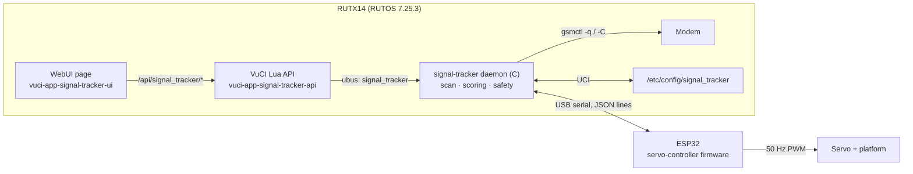

# Teltonika Cellular Signal Optimizer

Rotates a Teltonika RUTX router on a servo to find the orientation with the best cellular
signal. The router measures the signal and runs the optimization; an ESP32 connected over
**USB serial** drives the servo. A page in the standard RUTOS WebUI provides manual
positioning, automatic scanning and configuration.

## Architecture

| Component | Path | What it does |
|---|---|---|
| ESP32 firmware (ESP-IDF) | [`esp32/servo-controller`](esp32/servo-controller) | Executes `get_status` / `set_position` / `stop`, validates angles, rejects conflicting moves |
| Daemon (C, libubox/ubus/uci) | [`rutos/apps/signal-tracker`](rutos/apps/signal-tracker) | Serial link, signal sampling, asynchronous scan, ubus object, procd service |
| VuCI API (Lua) | [`rutos/apps/vuci-app-signal-tracker-api`](rutos/apps/vuci-app-signal-tracker-api) | `/api/signal_tracker/*` endpoints and UCI config endpoint, with ACLs |
| VuCI UI (Vue 3) | [`rutos/apps/vuci-app-signal-tracker-ui`](rutos/apps/vuci-app-signal-tracker-ui) | *Services → Signal Tracker* page |

The three RUTOS apps follow the SDK's own templates (`apps/example-app`,
`apps/vuci-app-example-api`, `apps/vuci-app-example-ui` in RUTX_R_SDK_00.07.25.3).

## Documentation

- [Hardware](docs/hardware.md): RUTX target, ESP32 board, USB connection, servo wiring
  and power, known limitations
- [USB serial protocol](docs/protocol.md)
- [Signal optimization algorithm](docs/algorithm.md): scan steps, scoring, missing
  data, cell changes, partial results
- [Build, install and use](docs/build-and-install.md): firmware and RUTOS package
  builds, installation, WebUI, configuration options

## Quick start

1. Upgrade the RUTX to **RUTX_R_00.07.25.3** (the backup shows 7.19.1; see
   [hardware](docs/hardware.md#router)).
2. Set the servo limits in `idf.py menuconfig`, then build and flash the ESP32 firmware.
3. Wire the servo to GPIO18 with its **own power supply** and a common ground. Connect the
   ESP32 board's USB port to the router.
4. Build the three apps with the SDK (`puf apps build ...`), install the `.ipk` files,
   enable the service and reboot once.
5. Open **Services → Signal Tracker**, check the controller shows *Connected*, try a
   manual move, then **Start Scan**.

## Verification status

Done on the development machine (Windows, no Linux host or hardware available):

| What | How | Result |
|---|---|---|
| ESP32 firmware build | ESP-IDF 5.4.0 via PlatformIO `espressif32@6.10.0`, target `esp32` | Builds, no warnings in project sources; 201 KB flash, 10 KB RAM |
| Firmware protocol logic | Host tests (`esp32/servo-controller/test`) | 145 checks pass |
| Daemon core: framing, parsing, scoring, link, motion, scan, safety, simulation | Host tests (`rutos/apps/signal-tracker/tests`), UBSan | 200 checks pass, including a run against the real firmware protocol code |
| Daemon for the router | Cross-compiled for armv7 hard-float musl against the SDK 7.25.3 sysroot headers and libraries | Compiles and links without warnings; all needed libraries exist in the 7.25.3 rootfs |
| WebUI view | Built with the SDK's `compile-vuci-app.sh` / vite pipeline | Builds; menu entry patched |
| Lua API | Loaded under LuaJIT 2.1 with mocks of `FunctionService`, `ConfigService`, `ubus` | Handlers and validators behave as intended |

**Not verified, needs a test on real hardware:**

- The `puf` SDK build and `.ipk` packaging (needs a Linux host)
- Runtime behaviour of the stock VuCI components and the Lua API framework
  (`ResponseError`, `ConfigService` named-section endpoint, `vuci-form` rendering).
  These follow the SDK examples but were not run on a router.
- `gsmctl` output on the RUTX14's modem and how often it refreshes values
- The actual ESP32 board, its USB bridge enumeration on the RUTX, DTR/RTS reset
  behaviour, servo calibration, power and mechanics
- A complete end-to-end scan on a live network

Suggested first hardware test: install with `option simulate '1'` to check the WebUI and
API, then switch to `0`, verify `ubus call signal_tracker status` shows the controller
connected, run manual moves with the platform unloaded, and only then a full scan.
