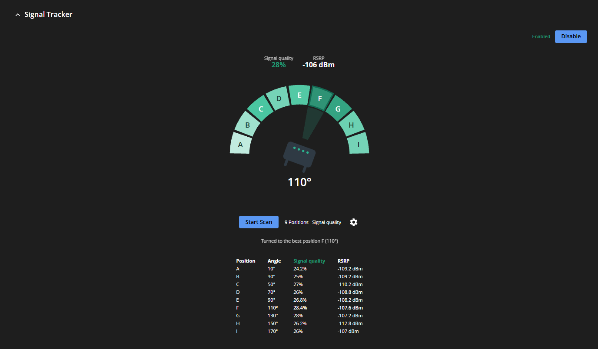
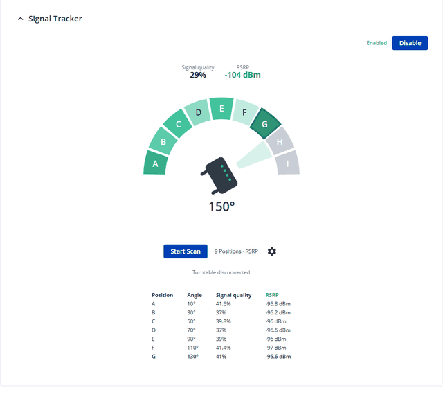

# Teltonika RUTOS Signal Tracker

Turns a Teltonika router on a servo turntable to find the direction with the best mobile
signal. An ESP8266 or ESP32 running the
[signal-tracker firmware](https://github.com/dominykasssx/signal-tracker) drives the servo;
the router talks to it over USB serial, measures the signal at each position and turns to
the best one.





On the router it is three RUTOS packages, laid out like the SDK's examples
(`example-app`, `vuci-app-example-api`, `vuci-app-example-ui`):

| Package | Path | What it holds |
|---|---|---|
| `signal-tracker` | [`rutos/apps/signal-tracker`](rutos/apps/signal-tracker) | The service (C, ubus object `signal_tracker`) and its init script, which writes `/etc/config/signal_tracker` |
| `vuci-app-signal-tracker-api` | [`rutos/apps/vuci-app-signal-tracker-api`](rutos/apps/vuci-app-signal-tracker-api) | VuCI API (Lua): `/api/signal_tracker/*` and `/api/signal_tracker_config/*`, with ACLs |
| `vuci-app-signal-tracker-ui` | [`rutos/apps/vuci-app-signal-tracker-ui`](rutos/apps/vuci-app-signal-tracker-ui) | The **Services → Signal Tracker** WebUI page (Vue) |

## Related

- **Turntable firmware:** [signal-tracker](https://github.com/dominykasssx/signal-tracker) — ESP8266 / ESP32 firmware for the servo platform, with a browser flasher, wiring and serial commands.
- **3D-printed stand:** STL files for the turntable on [Thingiverse](https://www.thingiverse.com/thing:7429147).

## How it works

- **Turntable.** The service uses the firmware's serial commands (115200 baud, one per
  line): `<deg>` turns there (`MOVING a -> b`, then `AT b` once it has stopped) and `?`
  reports `POS <deg> TARGET <deg> SPEED <ms/deg> MAX <travel>`. It sends `?` every 2 s,
  and every 250 ms while the platform moves, so the WebUI shows where it is live.
- **Travel** (180°, 270° or 360°) is read from the ESP (`MAX`). Set it once on the ESP
  from a serial terminal with `m180`, `m270` or `m360`; the ESP keeps it in flash.
- **Modem.** There is one turntable, so one modem is tracked: gsmd's `gsm.modem0` (the
  primary modem) or `gsm.modem1` (the secondary one), option `modem`. It is read every
  2 s: signal quality in % (`get_signal_quality_value`) and RSRP in dBm
  (`get_signal_query`).
- **Scan.** The travel is split into *positions* equal sectors, A, B, C, …, each measured
  at its centre. A 180° servo with 10 positions is measured at 9°, 27°, … 171°, 18° apart.
  At each position the service waits `settle` seconds, takes `samples` readings one
  second apart and averages them. It then turns to the position with the highest average
  of the `metric`, signal quality or RSRP. Both are recorded at every position. The scan
  starts from the end nearer the current angle.
- **Retries.** If the turntable's USB serial port disappears, the firmware restarts, or a
  move does not arrive in time, the scan does not fail at once. It waits up to 30 s for the
  turntable to report again, turns back to the position it was at and measures that
  position again from the start. It fails after 3 attempts in a row at one position.
- **Stop Scan** ends the scan; a move already under way still finishes.
- **Disabled** (`enabled '0'`, the Disable button), the service keeps running but reads
  no signal and releases the turntable's serial port, so the WebUI can switch it back on.
- **WebUI.** One view with an Enable/Disable button, the live signal quality and RSRP
  (the metric the scan uses is highlighted), and a ring of lettered sectors spanning the
  travel (a half circle for 180°, a full ring for 360°) with the router in the middle,
  turned to the live angle. Measured sectors are shaded by the metric, the best is
  outlined, and clicking a sector turns the router there. The gear button shows the
  settings: the metric, positions, timings, serial device, and, on a router with two
  modems, which one to measure (Primary or Secondary modem).

Check from the shell:

```sh
ubus call signal_tracker status
ubus call signal_tracker move '{"angle":90}'               # replies {"angle":90} once it is there
ubus call signal_tracker move '{"angle":90,"async":true}'  # replies at once
ubus call signal_tracker scan_start                         # with the settings' modem and metric
ubus call signal_tracker scan_stop
logread -e signal-tracker
```

## Settings (`/etc/config/signal_tracker`)

One section, `general`, which the service's start writes with these defaults when it is
missing (first start, an empty file, or a config from an older version with sections per
modem). The package installs no config file, so upgrades keep the settings.

```
config signal_tracker 'general'
	option enabled '1'
	option device 'auto'
	option modem '0'
	option metric 'signal_quality'
	option positions '8'
	option settle '15'
	option samples '5'
```

| Option | Default | Meaning |
|---|---|---|
| `enabled` | `1` | Read the modem and use the turntable |
| `device` | `auto` | Turntable serial port; `auto` picks the first USB serial port of an ESP board (`ch341`, `cp210x`, `ftdi_sio`, `pl2303`, `cdc_acm`, `ch343` drivers; the modem's ports are skipped). Restart the service after changing it |
| `modem` | `0` | The modem measured: `0` primary (`gsm.modem0`), `1` secondary (`gsm.modem1`) |
| `metric` | `signal_quality` | What a scan maximises: `signal_quality` (%) or `rsrp` (dBm) |
| `positions` | `8` | Sectors per scan, 2–26 (A–Z) |
| `settle` | `15` | Seconds to wait at a position before measuring |
| `samples` | `5` | Readings per position, 1 s apart |

The WebUI saves them through `/api/signal_tracker_config`, the Enable/Disable button
included; the service reads them at its next status call (within 2 s). Changes apply from
the next scan.

## Building

With the RUTX Puffin SDK (`RUTX_R_SDK_00.07.25.3`): copy the three directories in
`rutos/apps/` to the SDK's `apps/` and append
[`rutos/build.conf.apps`](rutos/build.conf.apps) to the `[apps]` section of the SDK's
`build.conf`. It lists the apps in build order (the service, then the API, then the UI)
with the packages' maintainer scripts, which Puffin only takes from `build.conf`. Then:

```sh
source init-build-env
puf build    # dist/packages/<app>_2.2.4_cortexa7hf-neon-vfpv4.ipk and the firmware in dist/
```

`puf build` empties `staging/` first. `puf apps build <app>` does not, and Puffin puts in an
app's package only the files its `make install` adds to `staging/`: files left there by an
earlier build are missing from the package.

## Installing

Either flash the firmware, which has the three packages built in, or install the packages
with opkg, in this order:

```sh
opkg install signal-tracker_2.2.4_cortexa7hf-neon-vfpv4.ipk \
    vuci-app-signal-tracker-api_2.2.4_cortexa7hf-neon-vfpv4.ipk \
    vuci-app-signal-tracker-ui_2.2.4_cortexa7hf-neon-vfpv4.ipk
```

The packages' scripts do the rest, as the firmware's own VuCI packages do: the service is
enabled and started (on an upgrade it is restarted, after a few seconds' stop), ubusd and
the session daemon reload their ACLs, uhttpd reloads the API routes and the WebUI its menu.
Upgrades keep the settings. `opkg remove` in the reverse order stops and disables the
service and withdraws the API and the page; the settings stay.

### From the package feed

The [Packages workflow](.github/workflows/packages.yml) builds the packages with the RUTX
SDK `RUTX_R_SDK_00.07.26` (for RUTOS 07.26 firmware) on every push. It keeps them as a
workflow artifact, attaches them to a release for `v*` tags, and on `main` publishes them on
GitHub Pages as an opkg feed signed with [`rutos/feed.pub`](rutos/feed.pub)'s key (the
repository secret `OPKG_FEED_KEY`). The router checks feed signatures, so add the key once,
then the feed:

```sh
wget -O /tmp/feed.pub https://dominykasssx.github.io/teltonika-signal-tracker/rutx/feed.pub
opkg-key add /tmp/feed.pub
echo 'src/gz signal_tracker https://dominykasssx.github.io/teltonika-signal-tracker/rutx' \
    > /etc/opkg/customfeeds.conf
opkg update
opkg install vuci-app-signal-tracker-ui    # pulls in the API and the service
```
